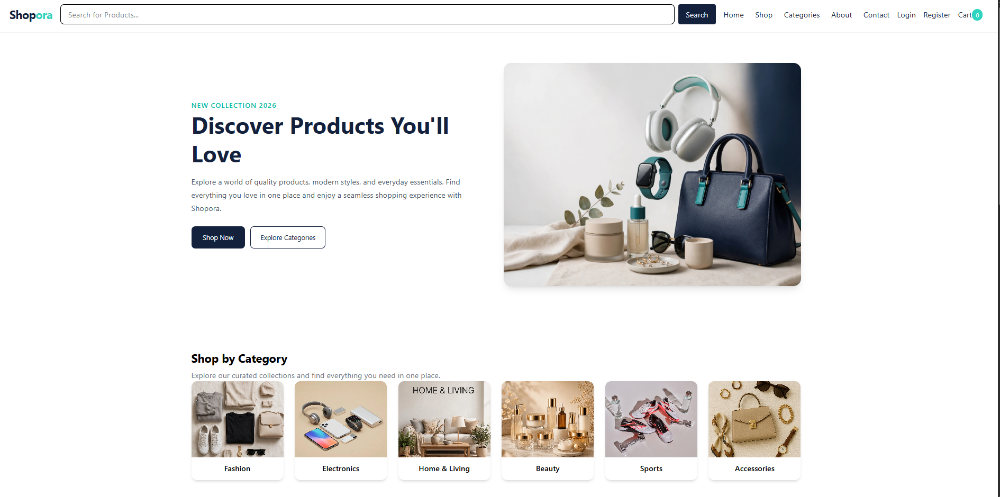
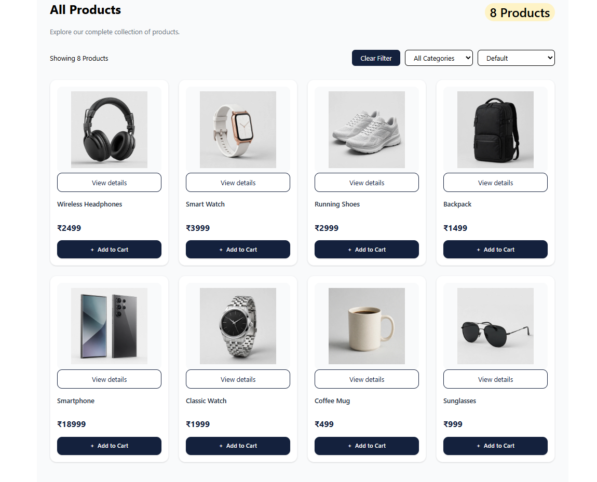
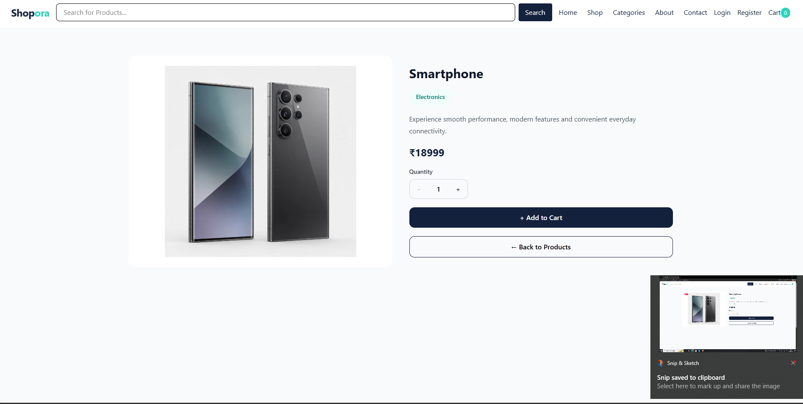
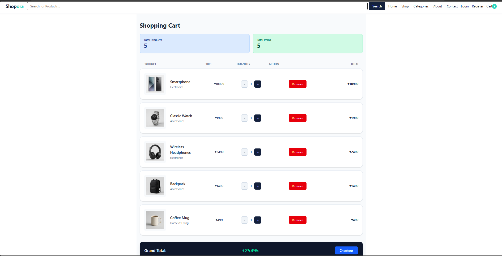
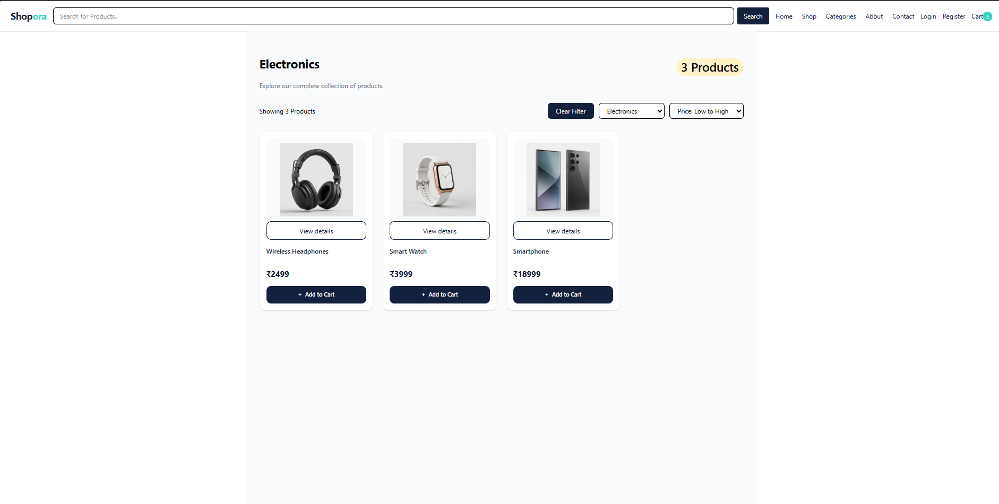
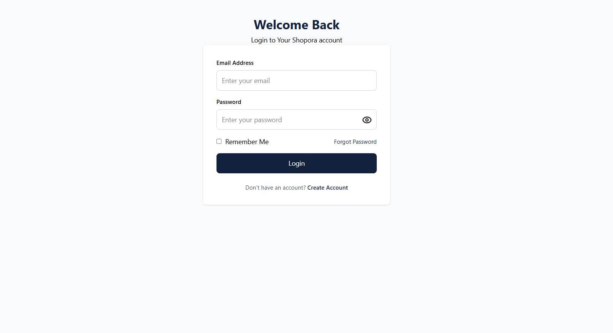
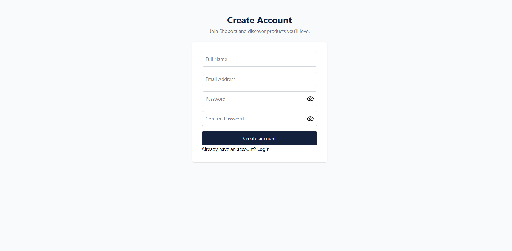

# Shopora – E-Commerce Web Application

**Shopora** is a modern e-commerce frontend application built with React and JavaScript. It provides an interactive shopping interface where users can browse products, search and filter items, view product details, and manage their shopping cart.

The project focuses on practical frontend development concepts, reusable React components, state management, and responsive user interface design.

<p align="center">
  <a href="https://shopora-ecommerce-nu.vercel.app/"><strong>Live Demo</strong></a> ·
  <a href="https://github.com/surajkhan-dev/shopora-ecommerce"><strong>GitHub Repository</strong></a>
</p>

---

## Screenshots

### Home Page


### Products Page


### Product Details


### Shopping Cart


### Category Filtering


### Login Page


### Registration Page


### Mobile View


---

## Features

- Responsive e-commerce user interface
- Product listing and browsing
- Product search by name
- Category-based product filtering
- Product sorting by name and price
- Individual product details
- Product quantity selection
- Add products to shopping cart
- Increase and decrease cart quantities
- Remove products from cart
- Dynamic cart item count
- Automatic cart total calculation
- Empty cart and no-search-results states
- Login and registration interfaces
- Basic client-side form validation
- Password visibility controls

## Application Pages

| Page | Description |
|---|---|
| Home | Landing page with product categories and featured content |
| Products | Product catalogue with search, filtering, and sorting |
| Product Details | Individual product information and quantity selection |
| Cart | Shopping cart with quantity controls and price calculation |
| About | Store information |
| Contact | Contact page interface |
| Login | Login form with basic validation |
| Register | Registration form with basic validation |

## Technology Stack

| Technology | Purpose |
|---|---|
| React.js | Component-based UI development |
| JavaScript (ES6+) | Application logic and functionality |
| Tailwind CSS | Utility-first styling |
| CSS3 | Additional styling |
| Vite | Development server and build tool |
| Lucide React | Icon library |
| Git | Version control |
| GitHub | Source code hosting |
| Vercel | Deployment |

## Project Structure

```text
shopora-ecommerce/
│
├── client/
│   ├── src/
│   │   ├── assets/
│   │   ├── components/
│   │   ├── data/
│   │   ├── pages/
│   │   ├── App.jsx
│   │   ├── App.css
│   │   ├── index.css
│   │   └── main.jsx
│   │
│   ├── index.html
│   └── package.json
│
├── screenshots/
│   ├── desktop-homepage.png
│   ├── products-page.png
│   ├── product-details.png
│   ├── shopping-cart.png
│   ├── category-filter.png
│   ├── login-page.png
│   ├── register-page.png
│   └── mobile-view.png
│
└── README.md
```

## Getting Started

Follow these instructions to run Shopora locally.

### Prerequisites

Make sure you have installed:

- Node.js
- npm

### Installation

**1. Clone the repository**

```bash
git clone https://github.com/surajkhan-dev/shopora-ecommerce.git
```

**2. Navigate to the client directory**

```bash
cd shopora-ecommerce/client
```

**3. Install dependencies**

```bash
npm install
```

**4. Start the development server**

```bash
npm run dev
```

**5. Open the local URL**

Open the URL displayed in your terminal, usually:

```text
http://localhost:5173
```

## Key Implementation Details

- Built the interface using reusable React components.
- Used React `useState` to manage application state and user interactions.
- Implemented product search, category filtering, and sorting.
- Managed shopping cart operations, including adding, removing, and updating product quantities.
- Used JavaScript array methods such as `filter()`, `map()`, `find()`, and `reduce()` to handle product and cart data.
- Calculated cart item counts and total prices dynamically.
- Organised the application into separate components, pages, and product data files.

## Current Limitations

Shopora is currently a frontend-focused project.

- Product data is stored locally in JavaScript.
- No backend API or database is connected.
- Login and registration are frontend interfaces with basic client-side validation; real authentication is not implemented.
- Cart data is managed through React state and is not persisted after a page refresh.
- Checkout is currently a demonstration and does not create real orders.
- No payment gateway is integrated.

## Future Improvements

- Develop a backend using Node.js and Express.js.
- Integrate MongoDB for data storage.
- Implement secure user authentication and authorization.
- Connect frontend pages with REST APIs.
- Add persistent shopping cart functionality.
- Implement order management and checkout.
- Integrate an online payment gateway.

## Author

**Suraj Khan**

B.Tech in Computer Science and Engineering (2024)

- **GitHub:** [surajkhan-dev](https://github.com/surajkhan-dev)
- **LinkedIn:** [Suraj Khan](https://www.linkedin.com/in/suraj-khan22/)

---

*Shopora is a personal portfolio project developed to strengthen practical frontend development skills and demonstrate e-commerce application functionality.*
